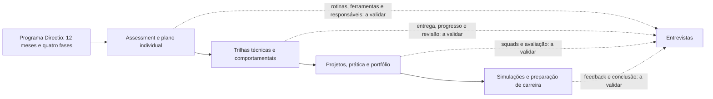
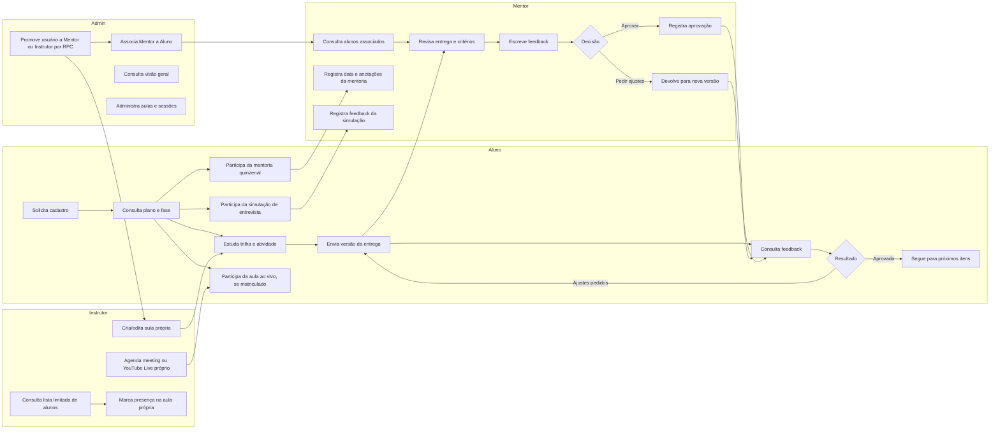

# 02 — Mapeamento de processos

> **Status:** proposta de processo futuro (TO-BE), não validada com a operação. O AS-IS abaixo registra somente o que as fontes permitem afirmar. Diagramas TO-BE são hipóteses de desenho e não descrevem funcionalidades já prontas.

## 1. Como ler este documento

- **AS-IS** é o que consta dos documentos atuais sobre o programa; rotinas operacionais não documentadas ficam marcadas **A validar nas entrevistas**.
- **TO-BE** é uma proposta para a plataforma Directio, alinhada aos requisitos do arquivo [01-levantamento-requisitos.md](01-levantamento-requisitos.md).
- “Dores” aparecem como **Hipótese a validar**, não como resultado de pesquisa.
- IDs de processo (`P-01` a `P-08`) são referências estáveis para entrevistas e rastreabilidade.

## 2. Processo atual (AS-IS)

Os documentos descrevem a estrutura do programa, mas não documentam ferramentas, responsáveis, cadências de comunicação, políticas de entrega ou sistemas atuais. Portanto, não se presume que o trabalho hoje seja feito por e-mail, planilhas ou qualquer sistema específico.

| ID | Parte do programa que está documentada | O que não está descrito e deve ser validado |
|---|---|---|
| P-01 Ingresso e diagnóstico | O aluno faz assessment de perfil e recebe um plano individual. | Como ocorre inscrição, consentimento, seleção, cadastro, criação do plano, atribuição de mentor e promoção para Instrutor. **A validar nas entrevistas.** |
| P-02 Estudo da trilha | Há trilhas personalizadas com conteúdo técnico e comportamental em módulos progressivos. | Onde ficam conteúdos, como são liberados, como se registra progresso e quem atualiza trilhas. **A validar nas entrevistas.** |
| P-03 Atividade e entrega | O currículo contempla fundamentos, trilhas, workshops, projetos e portfólio. | Quais entregas são exigidas, formatos, prazos, critérios, canal de envio e histórico de versões. **A validar nas entrevistas.** |
| P-04 Revisão e feedback | O programa prevê acompanhamento humano e feedback estruturado em simulações; as solicitações anteriores pedem revisão de entregas por mentor. | Quem revisa cada item, fila, critérios, prazos internos, escalas, aprovações e reenvios. **A validar nas entrevistas.** |
| P-05 Squad | O pedido atual informa trabalho em squads heterogêneos e projetos em grupo aparecem na fase Desenvolver. | Formação, composição, acompanhamento, divisão de contribuições, entregas e avaliação. **A validar nas entrevistas.** |
| P-06 Mentoria quinzenal | A fase Desenvolver inclui mentoria quinzenal; a visão geral do programa descreve acompanhamento a cada duas semanas. | Agendamento, formato, participantes, registro e visibilidade das anotações. **A validar nas entrevistas.** |
| P-07 Entrevista simulada | O documento do produto prevê simulação de entrevista técnica e comportamental. O pedido atual especifica live coding e fit cultural. | Como são conduzidas, ferramentas externas, critérios e devolutiva. **A validar nas entrevistas.** |
| P-08 Conclusão de fase | O programa tem quatro fases e itens por período. | Critérios de conclusão, avanço, exceções, recuperação ou decisão humana. **A validar nas entrevistas.** |
| P-09 Conteúdo instrucional | O pedido atual define que professores Instrutores criam aulas próprias, com vídeo YouTube; o programa descreve trilhas e módulos. | Como professores preparam, validam e publicam conteúdo hoje. **A validar nas entrevistas.** |
| P-10 Aula ao vivo | O pedido atual define sessões meeting/YouTube Live, presença e gravação ligada a aula. | Como aulas ao vivo são agendadas/canceladas, como presença é marcada e quais ferramentas são usadas. **A validar nas entrevistas.** |

### Visão AS-IS limitada às fontes

O fluxo representa a sequência geral descrita nos documentos do programa, não uma sequência operacional obrigatória para cada aluno.

## 3. Processo proposto (TO-BE)

### 3.1 Visão geral por perfil

O diagrama abaixo mostra uma hipótese de colaboração. As ações de sistema referem-se a requisitos planejados, com exceção da entrada por demonstração, que já possui um protótipo limitado.

**Hipótese a validar:** quem, além do aluno e mentor, inicia uma entrega de squad e como o Admin organiza alunos antes do início da jornada. Essas ações não foram detalhadas no diagrama como decisões já tomadas.

### 3.2 Processos propostos em detalhe

#### P-01 — Ingresso, cadastro e promoção de perfil

- **Gatilho:** pessoa solicita acesso à plataforma.
- **Atores:** Aluno, Admin; serviço de autenticação e backend.
- **TO-BE:** validar os dados mínimos → criar a conta com papel Aluno → autenticar → permitir acesso à área do aluno. Quando necessário, Admin revisa usuário e promove para Mentor → registra a alteração → associa o mentor a alunos.
- **Regras relacionadas:** RN-01, RN-05; RF-01 a RF-05 e RF-17.
- **Situação no código:** **Parcial** para sessão simulada/rotas; sem serviço real, persistência, promoção ou associação.
- **Dores que pode resolver:** perda de clareza sobre quem pode acessar cada área (**Hipótese a validar**).
- **A definir com a Altius:** aprovação de novos cadastros, campos necessários, verificação de identidade, como selecionar Admin e se a promoção exige aprovação adicional.

#### P-02 — Estudo de uma trilha

- **Gatilho:** aluno recebe ou consulta seu plano individual.
- **Atores:** Aluno; equipe Altius que mantém conteúdo; backend.
- **TO-BE:** identificar a fase → abrir trilha → consultar módulos e aulas → iniciar conteúdo → registrar progresso → mostrar próximo item conforme regra validada.
- **Regras relacionadas:** RN-08; RF-06, RF-07 e RF-14.
- **Situação no código:** **Implementado** para jornada e progresso; trilhas personalizadas continuam A definir com a Altius.
- **Dores que pode resolver:** dificuldade de encontrar conteúdo e entender o próximo passo (**Hipótese a validar**).
- **A definir com a Altius:** estrutura do conteúdo, mídia suportada, progresso mínimo por aula, liberação sequencial ou livre e regra de personalização.

#### P-03 — Envio e revisão de entrega individual

- **Gatilho:** aluno inicia atividade disponibilizada na sua jornada.
- **Atores:** Aluno, Mentor associado, backend; serviço de storage se houver arquivo.
- **TO-BE:** ler enunciado, critérios e prazo → preparar texto/link ou arquivo via adaptador de storage → enviar versão numerada e imutável → registrar envio → disponibilizar na fila de revisão → mentor avalia critérios e escreve feedback → aprova ou pede ajustes → aluno recebe notificação e consulta devolutiva → se houver ajustes, cria nova versão e reenvia.
- **Regras relacionadas:** RN-02 a RN-06; RF-08 a RF-10, RF-12, RF-13 e RF-18.
- **Situação no código:** **Implementado** para atividade, envio texto/link, versões, revisão e notificação; upload não configurado.
- **Dores que pode resolver:** dificuldade de acompanhar versões e localizar feedback (**Hipótese a validar**).
- **A definir com a Altius:** prazo e política de atraso, formato máximo de envio, critérios/pesos, quem revisa, prazo de revisão e se uma entrega aprovada pode ser reaberta.

#### P-04 — Entrega de squad

- **Gatilho:** atividade de grupo é disponibilizada para um squad.
- **Atores:** alunos do squad, Mentor associado e Admin/equipe Altius conforme permissões.
- **TO-BE:** Admin/equipe configura squad conforme regra aprovada → alunos identificam participantes e atividade → grupo prepara entrega → integrantes enviam ou confirmam participação conforme regra escolhida → mentor revisa → sistema registra feedback comum e, se aplicável, avaliação individual.
- **Regras relacionadas:** RN-05 e RN-06; RF-11 a RF-13.
- **Situação no código:** **Fora do escopo desta versão**; squads e regras seguem A definir com a Altius.
- **Dores que pode resolver:** falta de clareza de autoria, acompanhamento do grupo e feedback (**Hipótese a validar**).
- **A definir com a Altius:** composição heterogênea, tamanho dos grupos, mudanças de integrantes, autoria da entrega, feedback coletivo/individual e dados visíveis a cada participante.

#### P-05 — Registro de mentoria quinzenal

- **Gatilho:** realização de uma sessão de mentoria no ciclo quinzenal.
- **Atores:** Aluno e Mentor; backend.
- **TO-BE:** participantes realizam a sessão no formato definido pela Altius → Mentor registra data e anotações → registro fica acessível apenas às pessoas autorizadas → Aluno consulta o registro se a política permitir.
- **Regras relacionadas:** RN-05 e RN-07; RF-15.
- **Situação no código:** **Implementado no frontend/demo**; persistência real depende de configurar Supabase.
- **Dores que pode resolver:** perda de continuidade entre encontros (**Hipótese a validar**).
- **A definir com a Altius:** quem registra, quem visualiza, edição/correção, prazo de retenção e eventual registro de ausência. Este requisito não define formato, duração ou pauta da sessão.

#### P-06 — Simulação de entrevista

- **Gatilho:** aluno participa de uma simulação prevista no programa.
- **Atores:** Aluno e Mentor/avaliador; backend. Ferramenta de live coding, se necessária, é externa à plataforma nesta especificação.
- **TO-BE:** Aluno realiza simulação técnica/comportamental conforme formato aprovado → avaliador registra feedback estruturado sobre os critérios definidos → aluno consulta a devolutiva.
- **Regras relacionadas:** RF-16 e RF-18; acesso condicionado à RN-05.
- **Situação no código:** **Não implementado**; formato e critérios A definir com a Altius.
- **Dores que pode resolver:** feedback disperso após simulação (**Hipótese a validar**).
- **A definir com a Altius:** formato de live coding e fit cultural, critérios, uso de ferramentas externas, gravação (não presumida), acesso e retenção das avaliações.

#### P-07 — Conclusão de fase

- **Gatilho:** aluno conclui atividades ou chega ao período de encerramento de uma fase.
- **Atores:** Aluno, Mentor e Admin/equipe Altius conforme critérios definidos.
- **TO-BE:** plataforma reúne progresso e entregas → verifica regra de conclusão aprovada pela Altius → apresenta pendências → encaminha para decisão automática ou humana conforme política → atualiza fase se autorizado.
- **Regras relacionadas:** RN-02, RN-04 e RN-08; RF-07, RF-08 e RF-14.
- **Situação no código:** **Parcial** — fase/progresso exibidos, mas critérios de conclusão e avanço ainda não foram definidos.
- **Dores que pode resolver:** incerteza sobre progresso e requisitos para avançar (**Hipótese a validar**).
- **A definir com a Altius:** critérios de conclusão, tratamento de pendências, exceções, necessidade de aprovação humana e se calendário define fase ou apenas orienta.

#### P-08 — Administração de acessos e visão geral

- **Gatilho:** usuário precisa de acesso de Mentor ou Admin precisa revisar acompanhamento.
- **Atores:** Admin; backend.
- **TO-BE:** Admin localiza usuário → promove ou remove papel de Mentor conforme regra → associa Mentor a Aluno → consulta visão geral de alunos, vínculos e entregas pendentes → ações relevantes ficam auditadas.
- **Regras relacionadas:** RN-01 e RN-05; RF-04 e RF-17; RNF-01 e RNF-08.
- **Situação no código:** **Implementado** em UI, RPC e migration; aplicar e testar Supabase ainda pendente.
- **Dores que pode resolver:** falta de visibilidade operacional (**Hipótese a validar**).
- **A definir com a Altius:** papéis de equipe, dados do painel, mudanças de vínculo, trilha de auditoria e ações que exigem confirmação.

#### P-09 — Criar e publicar vídeo-aula

- **Gatilho:** Admin ou Instrutor prepara novo conteúdo de aula.
- **Atores:** Admin, Instrutor autor, YouTube/oEmbed ou Edge Function.
- **TO-BE:** Instrutor envia vídeo ao canal Altius no YouTube Studio como “Não listado” com incorporação permitida → cola link em `/app/admin/aulas` → parser aceita somente hosts configurados e formatos YouTube autorizados → extrai ID de 11 caracteres → busca metadados → salva somente `youtube_video_id` → Instrutor revisa título, eixo, posição e status → salva rascunho ou publica → aluno/mentor autorizado vê apenas publicada. Exclusão pede confirmação.
- **Regras relacionadas:** RN-11 a RN-13, RN-16 e RN-17; RF-26, RF-28 a RF-31.
- **Situação no código:** **Implementado** em UI, parser, player, adapter e migration; deployment Supabase pendente.
- **Dores que pode resolver:** conteúdo disperso e falta de contexto entre vídeo e trilha (**Hipótese a validar**).
- **Limites de acesso:** Admin pode gerir todas as aulas; Instrutor apenas as próprias; aluno/mentor lê publicada. O ID, nunca a URL digitada, é armazenado/renderizado.
- **A definir com a Altius:** allowlist de domínios, campos do formulário além de eixo/posição/status, papel que publica, política de exclusão/histórico e credencial/serviço para verificar incorporação.

#### P-10 — Gerenciar e participar de aula ao vivo

- **Gatilho:** Admin ou Instrutor autor agenda uma sessão.
- **Atores:** Admin, Instrutor autor, Aluno/Mentor autenticados e matriculados.
- **TO-BE:** autor escolhe `meeting` e URL HTTPS ou `youtube_live` e ID YouTube → define data/hora exibida em `America/Sao_Paulo` → agenda ou cancela → matriculados veem sessão agendada/cancelada → meeting oferece “Entrar na aula”; transmissão informa horário antes do início e usa o player comum ao vivo → depois, Admin ou Instrutor dono vincula aula gravada já cadastrada.
- **Regras relacionadas:** RN-11, RN-14, RN-16 e RN-18; RF-32, RF-33.
- **Situação no código:** **Implementado no frontend/demo**; persistência real depende de configurar Supabase.
- **Dores que pode resolver:** falta de clareza sobre agenda e acesso à sessão (**Hipótese a validar**).
- **Limites de acesso:** somente usuário logado e matriculado vê link/player. Não incluir chat. Sessão cancelada permanece visível como cancelada.
- **A definir com a Altius:** estados além de agendada/cancelada, regras de gravação, horário, permissões de edição e política se a transmissão falhar.

#### P-11 — Lista restrita de alunos, presença e administração de Instrutor

- **Gatilho:** Instrutor prepara aula, registra presença ou Admin revisa papéis.
- **Atores:** Instrutor, Admin e backend Supabase.
- **TO-BE:** Instrutor solicita lista por RPC segura e vê somente nome, fase, progresso e última atividade → registra presença apenas em aula própria. Admin promove usuário a Mentor/Instrutor por RPC com checagem de `auth.uid()`/papel e grava evento em `audit_log` → Admin pode consultar visão completa e administrar todos os registros.
- **Regras relacionadas:** RN-10, RN-11 e RN-15; RF-17, RF-34 a RF-36; RNF-10 e RNF-11.
- **Situação no código:** **Implementado** com demo Instrutor e RPC/RLS versionadas; deployment e testes pendentes.
- **Dores que pode resolver:** necessidade de dar ao professor dados suficientes para aula sem expor dados administrativos (**Hipótese a validar**).
- **A definir com a Altius:** colunas completas da lista Admin, dados de presença, retenção e eventuais funções adicionais.

## 4. Suposições e lacunas

- **Hipótese a validar:** centralizar trilha, entrega, revisão e mentoria reduzirá trabalho de coordenação e perda de contexto.
- O processo atual não pode ser descrito além do conteúdo do programa até que as entrevistas confirmem ferramentas, responsáveis e exceções.
- Os fluxos TO-BE não assumem uma política de prazo, uma escala de nota, composição de squad, agendamento de mentorias ou critérios de avanço.
- A plataforma não fará chat, videochamada, hospedagem de vídeo, editor de código nem envio de desafios de empresas; ferramentas para atividades ao vivo, se necessárias, ficam **A definir com a Altius** fora destes fluxos.
- A plataforma pode incorporar YouTube, mas não hospedará os vídeos; “Não listado” é compartilhável por qualquer pessoa com o link e não é proteção de conteúdo confidencial.
- As ações com privilégios Supabase dependem de RLS/RPC segura; a navegação por papel não autoriza leitura ou escrita no servidor.
- A autorização por perfil e vínculo precisa ser implementada no servidor. Guardas React existentes não são controle de segurança.
