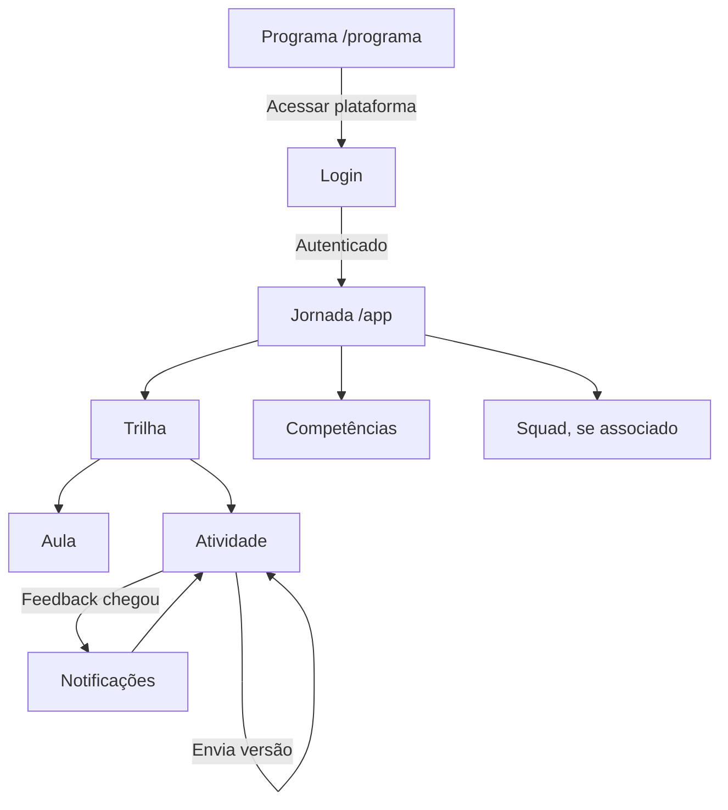
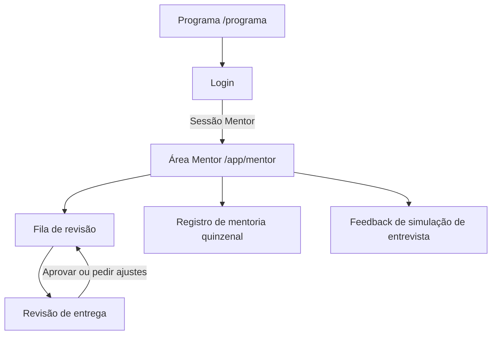
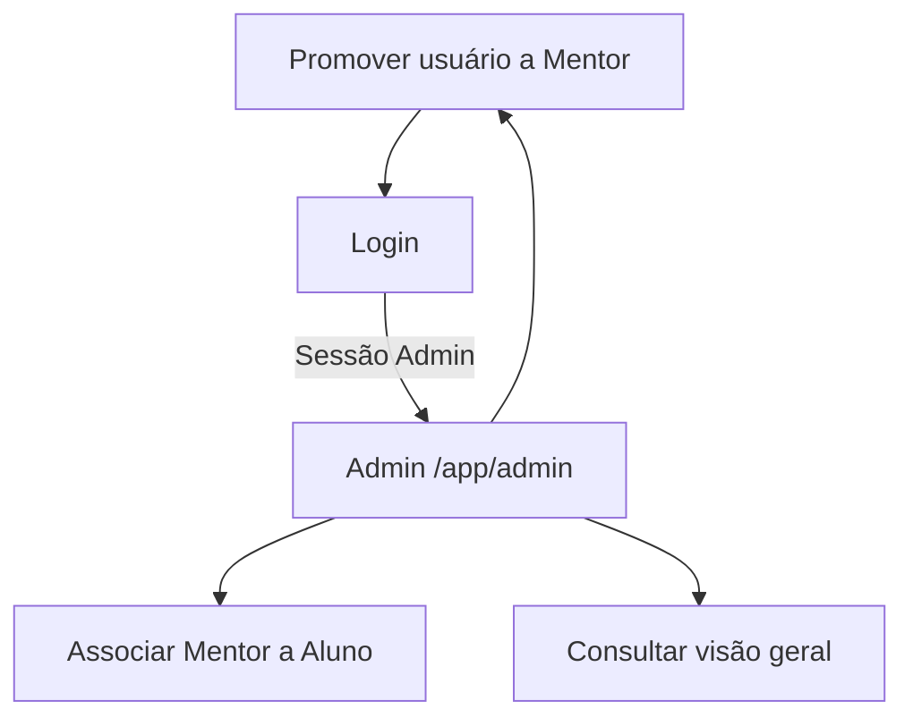

# 05 :  Prototipação

> **Status:** mapa e wireframes de referência. As telas da plataforma estão implementadas no frontend; operações reais dependem de configurar/aplicar Supabase. O modo demo é separado e não representa autenticação real.

## 1. Mapa de telas

Status significa presença no código atual, conferida em `src/App.jsx`, `src/pages/` e `src/features/`:

- **Implementado:** tela e comportamento principal localizados no código.
- **Parcial:** existe estrutura/interface, mas o fluxo está limitado ou bloqueado.
- **Planejado:** não há tela funcional correspondente no código.

| ID | Rota | Perfil com acesso | Histórias | Estados de UI necessários | Estado no código |
|---|---|---|---|---|---|
| TELA-01 | `/programa` | Público | US-23 | Conteúdo público; navegação móvel; foco e erro de navegação | **Implementado** :  página pública do programa; acesso à plataforma e checkout permanecem disponíveis. |
| TELA-02 | `/login`, `/registro`, `/recuperar-senha` | Público; se autenticado, segue para a área logada | US-01 a US-04 | Carregando; validação; serviço indisponível; erro; sessão existente; opção demo quando habilitada | **Parcial** :  formulários/rotas existem; ações reais ficam indisponíveis sem provedor. Demo aparece somente quando habilitada em ambiente não produtivo. |
| TELA-03 | `/app` | Aluno, Mentor, Instrutor e Admin | US-03 a US-07, US-15 | Vazio; carregando; erro; sem permissão; conteúdo indefinido; dados demo | **Implementado** :  página inicial contextual por perfil, conectada aos adaptadores e às áreas existentes. |
| TELA-04 | `/app/trilhas/:trailId` | Aluno associado à trilha | US-06, US-07 | Vazio; carregando; erro; sem permissão; conteúdo indefinido | **Não implementado** :  navegação das fases e aulas existe; trilhas personalizadas não foram definidas. |
| TELA-05 | `/app/aulas/:lessonId` | Aluno autenticado e matriculado; Mentor conforme permissão | US-06, US-07, US-26, US-38 | Vazio; carregando; erro; sem permissão; vídeo indisponível; botão manual de conclusão | **Implementado** :  player YouTube e conclusão manual; RLS depende de aplicação. |
| TELA-06 | `/app/atividades/:activityId` | Aluno dono ou participante autorizado | US-08 a US-10, US-14 | Vazio; carregando; erro; sem permissão; envio inválido; prazo vencido conforme política; revisão/feedback | **Implementado** :  atividade, envio de texto/link, versões e feedback; upload de arquivo não configurado. |
| TELA-07 | `/app/squads/:squadId` | Alunos participantes e Mentor autorizado | US-11 | Vazio; carregando; erro; sem permissão; grupo ou regra ainda indefinida | **Planejado** :  squad não existe no modelo ou código. |
| TELA-08 | `/app/mentor` | Mentor; Admin conforme escopo definido | US-12 | Fila vazia; carregando; erro; sem permissão; sem alunos associados | **Implementado** :  fila e revisão por papel; backend remoto pendente. |
| TELA-09 | `/app/mentor/revisoes/:submissionId` | Mentor associado; Admin conforme escopo definido | US-13 | Carregando; erro; sem permissão; critério indefinido; revisão salva; falha ao salvar | **Implementado** :  revisão por critério, comentário, aprovação ou pedido de ajustes. |
| TELA-10 | `/app/mentor/mentorias` | Mentor associado; Aluno conforme política de consulta | US-16 | Lista vazia; carregando; erro; sem permissão; confirmação de gravação | **Implementado** :  registro de mentoria limitado a data e anotações. |
| TELA-11 | `/app/mentor/entrevistas/:simulationId` | Mentor/avaliador autorizado; Aluno consulta devolutiva | US-17 | Vazio; carregando; erro; sem permissão; critério indefinido | **Não implementado** :  formato e critérios seguem A definir com a Altius. |
| TELA-12 | `/app/admin` | Admin | US-18 a US-20 | Vazio; carregando; erro; sem permissão; confirmação de alteração; falha ao salvar | **Implementado** :  visão geral, promoção e associação; depende de migration aplicada. |
| TELA-13 | `/app/notificacoes` ou painel de notificações | Usuário autenticado, limitado aos próprios avisos | US-21 | Vazio; carregando; erro; aviso lido/não lido; sem permissão | **Implementado** :  notificações in-app ao receber feedback. |
| TELA-14 | Rodapé da área logada, expansível | Usuário da demonstração | US-22 | Recolhido/expandido; ausência fora do modo demo | **Implementado** :  terminal recolhível com logs de exemplo rotulados na área logada. |
| TELA-15 | `/checkout` | Público | US-23 | Dados, pagamento indisponível, erro e confirmação bloqueada conforme configuração | **Parcial** :  fluxo/interface de checkout existe; pagamento depende de valor e provedor não configurados. |
| TELA-16 | `/app/admin/aulas` | Admin e Instrutor; Instrutor cria/edita/exclui apenas aulas próprias | US-24, US-25 | Vazio; carregando; erro; link inválido; metadados encontrados/não verificados; rascunho/publicada; confirmação de exclusão; sem permissão | **Implementado** :  gestão por Admin/Instrutor com ownership aplicado via RLS no servidor. |
| TELA-17 | `/app/alunos` | Admin; Instrutor via RPC com campos limitados | US-30 | Vazio; carregando; erro; sem permissão; lista Admin completa; lista Instrutor com nome/fase/progresso/última atividade | **Implementado** :  Admin recebe lista completa; Instrutor recebe apenas campos permitidos via RPC. |
| TELA-18 | `/app/ao-vivo` | Admin e Instrutor; Instrutor somente sessões próprias | US-27, US-29 | Vazio; carregando; erro; formulário meeting/youtube_live; cancelada; confirmação; sem permissão | **Implementado** :  gestão e listagem de sessões ao vivo por Admin/Instrutor. |
| TELA-19 | `/app/ao-vivo/:id` | Usuário autenticado matriculado; Admin e Instrutor dono para operação | US-28, US-29 | Agendada; aviso pré-início; em andamento; cancelada; gravação vinculada; falha de player; sem matrícula | **Implementado** :  meeting/YouTube Live, matrícula, horários e estado cancelado. |
| TELA-20 | `/app/mentores` | Admin | US-18 a US-20 | Vazio; carregando; erro; sem permissão; confirmação de associação | **Implementado** :  diretório restrito ao Admin. |
| TELA-21 | `/app/equipe` | Admin | US-18 a US-20 | Vazio; carregando; erro; sem permissão | **Implementado** :  diretório de equipe restrito ao Admin. |

As rotas descritas correspondem ao frontend atual; segurança definitiva depende das policies RLS aplicadas no Supabase. Admin tem acesso completo à área. Instrutor não recebe telas de visão geral completa, mentores ou equipe e não vê e-mail, mentor, matrícula ou auditoria. O servidor deverá repetir toda autorização por RLS/RPC; a sidebar e guards não são segurança.

### Estados de interface necessários

| Estado | Comportamento esperado |
|---|---|
| Vazio | Explicar que não há itens disponíveis e indicar próximo passo apenas quando aprovado pela Altius. Não mostrar números ou conteúdos de exemplo como dados reais. |
| Carregando | Comunicar carregamento de forma semântica e manter foco/navegação previsíveis. |
| Erro | Explicar que a operação falhou, preservar dados digitados quando seguro e oferecer nova tentativa quando aplicável. Não apresentar operação não persistida como concluída. |
| Sem permissão | Não revelar dados; informar que o acesso não está autorizado e oferecer retorno a rota permitida. A decisão final é do servidor. |
| Autenticação não configurada | Na tela atual, informar indisponibilidade e bloquear ações reais. A demo continua separada e exige variável habilitadora. |
| Conteúdo indefinido | Exibir “A definir com a Altius” para enunciado, critério, prazo ou instrução que ainda não foi fornecida. |
| Dados de demonstração | Exibir faixa fixa “Modo demonstração, dados de exemplo” e rotular logs/valores simulados. |

## 2. Fluxos de navegação propostos

### Aluno



### Mentor



### Admin



## 3. Wireframes textuais

Wireframes representam estrutura, não visual final ou dados confirmados. Em todas as telas da plataforma: fundo `#090d16`, paleta violeta-grafite existente, bordas de 1px, foco visível, contraste AA, navegação por teclado e `prefers-reduced-motion`. Conteúdo ausente fica marcado “A definir com a Altius”.

### TELA-03 :  Jornada do aluno

```text
┌────────── Altius Directio ──────────┬────────────────────────────────────┐
│ Sidebar enxuta                     │ Jornada                            │
│  Visão geral                       │ Fase atual: A definir com a Altius │
│  Trilhas                           │ Progresso: A definir com a Altius  │
│  Atividades                        │                                    │
│  Competências                      │ Explorar ─ Desenvolver ─ Aplicar ─ │
│                                    │ Decolar                            │
│                                    │                                    │
│                                    │ Próximo item: A definir com Altius │
│                                    │ Atividades                         │
│                                    │ [lista com estado e prazo]         │
│                                    │                                    │
│                                    │ Competências (6)                   │
│                                    │ [nome] [progresso, se houver dado] │
├────────────────────────────────────┴────────────────────────────────────┤
│ Terminal recolhível: somente em demo, logs identificados como exemplo  │
└─────────────────────────────────────────────────────────────────────────┘
```

Em mobile, a navegação lateral deve virar navegação compacta acessível; nenhuma fase ou atividade depende de hover.

### TELA-04 :  Trilha

```text
┌───────────────────────────────┐
│ Breadcrumb: Jornada / Trilha  │
│ Nome da trilha                │
│ Descrição: A definir...       │
│                               │
│ Módulos                       │
│ 01  Módulo :  A definir        │
│     Aulas e estado            │
│ 02  Módulo :  A definir        │
│     Aulas e estado            │
│                               │
│ Estado vazio / erro / loading │
└───────────────────────────────┘
```

### TELA-05 :  Aula

```text
┌─────────────────────────────────────────────────────────┐
│ Breadcrumb: Jornada / Trilha / Aula                     │
│ Título da aula :  A definir com a Altius                 │
│ Eixo: A definir com a Altius                              │
│ Conteúdo da aula :  A definir com a Altius                │
│ ┌────────────────── player YouTube 16:9 ───────────────┐ │
│ │ vídeo carregado do ID validado                       │ │
│ └──────────────────────────────────────────────────────┘ │
│ Se falhar: “Não foi possível carregar o vídeo aqui”      │
│ [Assistir no YouTube]                                    │
│                                                         │
│ [Marcar como concluída] :  ação manual do aluno           │
│ [Voltar à trilha]                         [Próxima aula] │
└─────────────────────────────────────────────────────────┘
```

O player usa `https://www.youtube-nocookie.com/embed/{ID}?rel=0&modestbranding=1`, `title` descritivo, `allowfullscreen`, `loading="lazy"`, `referrerpolicy="strict-origin-when-cross-origin"` e container 16:9 responsivo. A URL digitada pelo Instrutor nunca aparece na tela do aluno. O término do vídeo pode destacar o botão, mas não marca conclusão sozinho.

Não presumir formato de mídia, duração, hospedagem de vídeo ou editor de código na plataforma.

### TELA-06 :  Atividade e entrega

```text
┌──────────────────────────────────────────────────────────┐
│ Breadcrumb: Jornada / Fase / Atividade                   │
│ Título :  A definir com a Altius       Estado: [estado]   │
│ Prazo: A definir com a Altius                             │
│ Enunciado: A definir com a Altius                         │
│ Critérios: A definir com a Altius                         │
│                                                          │
│ Sua entrega                                               │
│ [campo de texto] [campo de link] [arquivo via adapter]   │
│ [Enviar versão]                                           │
│                                                          │
│ Histórico de versões                                     │
│ v1 · data · status · feedback relacionado                 │
│                                                          │
│ Feedback do Mentor                                       │
│ Nota/critérios: A definir · comentários                   │
└──────────────────────────────────────────────────────────┘
```

Validar se feedback pode ser rascunho, quais critérios são obrigatórios e se o conteúdo da versão fica congelado após envio. Upload só após adapter de storage.

### TELA-07 :  Entrega de squad

```text
┌───────────────────────────────────────────────────────┐
│ Squad: identificação conforme regra a definir         │
│ Participantes autorizados                             │
│ Atividade: A definir com a Altius                     │
│ Regra de autoria/avaliação: A definir com a Altius    │
│ Evidência/entrega                                     │
│ Feedback e critérios, se publicados                   │
└───────────────────────────────────────────────────────┘
```

### TELA-08 :  Área do mentor e fila

```text
┌───────────┬────────────────────────────────────────────┐
│ Navegação │ Alunos acompanhados                        │
│ Visão     │ [lista compacta; somente vínculos válidos]  │
│ Revisões  │                                            │
│ Mentorias │ Entregas pendentes                          │
│           │ Aluno | Atividade | Envio | Estado          │
│           │ [Abrir revisão]                             │
│           │ Estado vazio / carregando / erro / sem permissão│
└───────────┴────────────────────────────────────────────┘
```

### TELA-09 :  Revisão do mentor

```text
┌─────────────────────────────────────────────────────────┐
│ Aluno associado · atividade · versão                    │
│ Entrega (texto/link/metadados de arquivo)                │
│ Critérios publicados                                     │
│ Critério 1: A definir       [avaliação] [comentário]     │
│ Critério 2: A definir       [avaliação] [comentário]     │
│ Feedback geral                                           │
│ [Salvar feedback] [Aprovar] [Pedir ajustes]              │
│ Ação e autoria registradas conforme política definida   │
└─────────────────────────────────────────────────────────┘
```

### TELA-10 e TELA-11 :  Mentoria e simulação

```text
Mentoria quinzenal
  Aluno associado
  Data
  Anotações
  [Salvar registro]

Simulação de entrevista
  Tipo/formato: A definir com a Altius
  Critérios de live coding e fit cultural: A definir
  Feedback estruturado: A definir com a Altius
  [Salvar feedback]
```

Não incluir interface de videochamada, hospedagem de gravação ou editor de código.

### TELA-12 :  Painel Admin

```text
┌────────────┬────────────────────────────────────────────┐
│ Admin      │ Visão geral completa                        │
│ Visão geral│ Alunos | mentores | instrutores | aulas     │
│ Aulas      │ Usuários                                    │
│ Ao vivo    │ Pessoa | papel | ação                      │
│ Alunos     │ [Promover a Mentor] [Promover a Instrutor]  │
│ Mentores   │                                            │
│ Equipe     │ Associação Mentor ↔ Aluno                  │
│            │ [seletores, confirmação e salvamento]      │
└────────────┴────────────────────────────────────────────┘
```

Admin tem acesso completo à área. O servidor/RPC valida promoção e associação. Dados do painel que ainda não foram definidos ficam “A definir com a Altius”. A lista completa de campos de Admin é **A definir com a Altius**.

### TELA-16 :  Cadastro de vídeo-aula (Admin/Instrutor)

```text
┌───────────────────────────────────────────────────────────┐
│ Aulas > Nova aula                                         │
│ Título [pré-preenchido após verificação]                  │
│ Eixo [A definir]             Posição [número de ordem]    │
│ Link do YouTube [campo de entrada; não persistir URL]     │
│ [Verificar link]                                          │
│ Miniatura [prévia]  Verificação: [verificado / não foi...]│
│ Instruções rápidas do YouTube Studio                     │
│ Aviso: Não listado não é segurança; quem tem link assiste.│
│ Status [Rascunho / Publicada]                             │
│ [Salvar rascunho] [Publicar] [Excluir…]                  │
└───────────────────────────────────────────────────────────┘
```

`src/content/admin.js` deve fornecer instruções curtas: subir no YouTube Studio do canal Altius; escolher “Não listado”; ativar “Permitir incorporação”; não usar conteúdo confidencial. Excluir exige confirmação. Instrutor só altera aula própria; Admin administra qualquer uma. Aluno e Mentor veem apenas publicadas.

### TELA-17 :  Lista de alunos

```text
Admin: lista completa conforme política administrativa aprovada
  Campos: A definir com a Altius

Instrutor (RPC restrita, sem acesso direto a profiles):
  Nome | Fase | Progresso | Última atividade
```

A lista do Instrutor não deve conter filtros que permitam recuperar colunas vedadas, exportação com dados extras, e-mail, Mentor, situação da matrícula ou auditoria.

### TELA-18 :  Gestão de aulas ao vivo

```text
┌───────────────────────────────────────────────────────────┐
│ Aulas ao vivo                              [Nova aula]    │
│ Modo [meeting | youtube_live]                             │
│ meeting: URL https://...                                  │
│ youtube_live: link/ID YouTube validado                    │
│ Data e hora :  exibida em America/Sao_Paulo                │
│ Status [Rascunho / Agendada / Cancelada / ... a definir]  │
│ Gravação depois da aula [selecionar aula publicada]       │
│ [Salvar] [Cancelar sessão…]                               │
│ Lista: aulas próprias do Instrutor / visão Admin           │
└───────────────────────────────────────────────────────────┘
```

Instrutor só cria/edita sessão própria e marca presença nas suas aulas. Admin pode administrar todas. Link `meeting_url` e ID de YouTube são mutuamente exclusivos conforme `mode`.

### TELA-19 :  Participação na aula ao vivo

```text
┌───────────────────────────────────────────────────────────┐
│ Título · Data/hora em America/Sao_Paulo                   │
│ Status: Agendada / Cancelada / A definir                   │
│ Se meeting: [Entrar na aula]                               │
│ Se youtube_live: aviso antes do início; depois YouTubePlayer│
│ Sem chat incorporado                                       │
│ Se cancelada: aviso visível, sem botão de entrada ativo    │
│ Se gravação vinculada: link para a vídeo-aula publicada   │
│ Chamada (Instrutor dono): lista autorizada e presença      │
└───────────────────────────────────────────────────────────┘
```

Aluno e Mentor só recebem link/player quando autenticados e matriculados. Não renderizar link externo ou ID protegido em páginas públicas.

## 4. Como acessar o protótipo demo atual

No projeto atual, executar localmente:

```bash
npm install
```

Criar `.env.local` na raiz com:

```env
VITE_DEMO_MODE=true
```

Depois executar `npm run dev` e abrir `/login`. No código atual, selecionar Aluno, Mentor, Instrutor ou Admin em “Acesso de demonstração” e entrar. A variável não habilita a demo em build de produção. Depois da apresentação, remover/desabilitar a variável.

### O que a demo atual mostra

1. Formulários visuais de login, cadastro e recuperação; as ações e campos ficam bloqueados enquanto não há serviço de autenticação configurado. A validação existe no código, mas não pode ser exercida pelo formulário nesse estado.
2. Mensagem de autenticação não configurada e botões reais bloqueados.
3. Seletor de papel com sessão local de demonstração.
4. Guards de navegação e sidebar condicionados ao papel.
5. Jornada, atividades, entregas, feedback, aulas, sessões ao vivo e áreas administrativas com persistência local marcada como exemplo.
6. Faixa fixa “Modo demonstração, dados de exemplo” e terminal retrátil com logs rotulados.

### O que a demo não mostra

Supabase configurado na Altius, autenticação real funcional sem credenciais do ambiente, upload de arquivos, squads, entrevistas, RLS aplicada/testada e persistência real. Não apresentar dados locais como registros reais.

### Dados de demo que devem ser adicionados

Os dados abaixo existem no modo demo, são sintéticos e não podem ser apresentados como conteúdo real:

| Registro de exemplo | Dados demonstrativos | Avisos |
|---|---|---|
| Usuário Instrutor | `id=demo-instructor`, `role=instructor`, nome visível “Instrutor de exemplo” | Não usar dados pessoais/e-mail reais. |
| Vídeo-aula 1 | ID sintético `DEMOEXEMP01`, título “Vídeo-aula de exemplo 1”, estado exemplo | ID tem 11 caracteres para exercitar o parser; não é conteúdo publicado do programa. |
| Vídeo-aula 2 | ID sintético `DEMOEXEMP02`, título “Vídeo-aula de exemplo 2”, estado exemplo | Mesmo aviso. |
| Vídeo-aula 3 | ID sintético `DEMOEXEMP03`, título “Vídeo-aula de exemplo 3”, estado exemplo | Mesmo aviso. |
| Aula `meeting` | `meeting_url=https://example.com/aula-demo`, sessão identificada como exemplo | URL não é sala real e não pode ser apresentada como convite funcional. |
| Aula `youtube_live` | ID sintético `DEMOEXEMP04`, sessão identificada como exemplo | Sem transmissão real; mostrar que é dado de demonstração. |

Datas de demonstração também devem ser explicitamente rotuladas como exemplo. Dados do Instrutor não concedem acesso a matrícula, perfis completos, associação de mentores ou auditoria. O Instrutor demo deve receber as mesmas restrições de colunas/rotas que o papel real.

## 5. Decisões de design para validar

- Sidebar curta em desktop; navegação recolhida e acessível em viewport móvel.
- Listas e linhas de status para atividades, revisões e usuários; evitar grades repetitivas de cards.
- Cor reservada a status, nota e ação principal; sem glow, neon ou glassmorphism novo.
- Estados vazios, erros, loading, sem permissão e dados de exemplo explícitos.
- Fluxos completos via teclado, ordem de foco previsível, foco visível, labels associados e feedback anunciado por tecnologia assistiva.
- Contraste AA e `prefers-reduced-motion`; movimento não pode ser necessário para entender progresso.
- Validar rótulos “fase”, “trilha”, “módulo”, “aula”, “atividade”, “entrega” e “feedback” com alunos e mentores.
- Validar com Altius se o painel de competências apresenta nível, evidência ou somente histórico; não inventar nota ou fórmula.
- Validar se versões ficam visíveis a todas as pessoas do squad e como se distinguem feedback individual e coletivo.

## 6. Suposições e lacunas

- As rotas de estudo e operação são propostas para prototipação; somente as rotas enumeradas em “Status no código” existem hoje.
- O protótipo funcional atual cobre o shell, não a jornada Directio completa.
- A composição visual segue tokens e referências descritas em `CLAUDE.md`/`docs/design-plan.md`; validação de contraste AA ainda precisa ser feita por ferramenta e revisão com usuários.
- Conteúdo, regras de progresso, prazos, critérios, política de versões, indicadores, painel Admin, visibilidade de squads e campos de feedback seguem **A definir com a Altius**.
